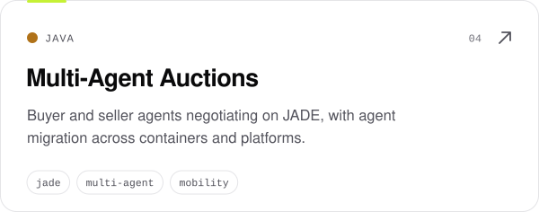
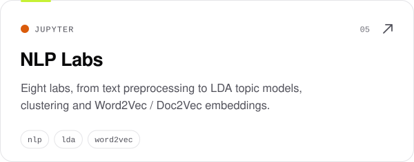
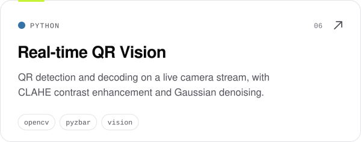

<!--
  Profile README. The visuals in assets/ are generated by scripts/build-assets.mjs:
  edit the texts there, then run `node scripts/build-assets.mjs` and commit.
-->

<picture>
  <source media="(prefers-color-scheme: dark)" srcset="https://raw.githubusercontent.com/SaadaSamir/SaadaSamir/main/assets/hero-dark.svg">
  
</picture>

  <a href="https://dz.linkedin.com/in/samir-saada-5667b1245"><picture><source media="(prefers-color-scheme: dark)" srcset="https://raw.githubusercontent.com/SaadaSamir/SaadaSamir/main/assets/buttons/linkedin-dark.svg"></picture></a>&nbsp;
  <a href="mailto:saadasamir449@gmail.com"><picture><source media="(prefers-color-scheme: dark)" srcset="https://raw.githubusercontent.com/SaadaSamir/SaadaSamir/main/assets/buttons/email-dark.svg"></picture></a>&nbsp;
  <a href="mailto:saadasamir449@gmail.com?subject=Tadbir%20demo"><picture><source media="(prefers-color-scheme: dark)" srcset="https://raw.githubusercontent.com/SaadaSamir/SaadaSamir/main/assets/buttons/demo-dark.svg"></picture></a>

<picture>
  <source media="(prefers-color-scheme: dark)" srcset="https://raw.githubusercontent.com/SaadaSamir/SaadaSamir/main/assets/whoami-dark.svg">
  
</picture>

## Flagship project

<a href="mailto:saadasamir449@gmail.com?subject=Tadbir%20demo">
  <picture>
    <source media="(prefers-color-scheme: dark)" srcset="https://raw.githubusercontent.com/SaadaSamir/SaadaSamir/main/assets/tadbir-dark.svg">
    
  </picture>
</a>

**Tadbir** (تدبير, *management*) is the ERP I am building for Algerian SMEs, designed around local rules instead of patched onto them: the SCF chart of accounts, G50 returns and IBS installments, CNAS and IRG payroll. One workspace covers accounting from the first entry to the financial statements, then sales, purchases, stock, point of sale, CRM, projects and payroll, in French and Arabic.

Laravel 13 · Vue 3 with Inertia · Tailwind 4 · PostgreSQL 17 with row-level security · REST API · TOTP two-factor authentication. The repository is private; a live demo is available on request.

## Selected work

  <a href="https://github.com/SaadaSamir/Parallel-Word-Frequency-Counter"><picture><source media="(prefers-color-scheme: dark)" srcset="https://raw.githubusercontent.com/SaadaSamir/SaadaSamir/main/assets/cards/word-frequency-dark.svg"></picture></a>
  <a href="https://github.com/SaadaSamir/Mini-py-compiler"><picture><source media="(prefers-color-scheme: dark)" srcset="https://raw.githubusercontent.com/SaadaSamir/SaadaSamir/main/assets/cards/mini-py-compiler-dark.svg"></picture></a>
  <a href="https://github.com/SaadaSamir/TweetClassifierML"><picture><source media="(prefers-color-scheme: dark)" srcset="https://raw.githubusercontent.com/SaadaSamir/SaadaSamir/main/assets/cards/tweet-classifier-dark.svg"></picture></a>
  <a href="https://github.com/SaadaSamir/TECH-AGENT"><picture><source media="(prefers-color-scheme: dark)" srcset="https://raw.githubusercontent.com/SaadaSamir/SaadaSamir/main/assets/cards/tech-agent-dark.svg"></picture></a>
  <a href="https://github.com/SaadaSamir/Traitement-Automatique-du-Langage-Naturel"><picture><source media="(prefers-color-scheme: dark)" srcset="https://raw.githubusercontent.com/SaadaSamir/SaadaSamir/main/assets/cards/nlp-labs-dark.svg"></picture></a>
  <a href="https://github.com/SaadaSamir/QR-Code-detection-and-encryption-using-pyzbar"><picture><source media="(prefers-color-scheme: dark)" srcset="https://raw.githubusercontent.com/SaadaSamir/SaadaSamir/main/assets/cards/qr-vision-dark.svg"></picture></a>

Also here: [search and metaheuristics (BFS, DFS, A\*, GA, BSO)](https://github.com/SaadaSamir/Metaheuristic-Project) · [semaphore-synchronised medical cabinet in C](https://github.com/SaadaSamir/semaphore-threaded-medical-cabinet-system) · [data mining labs](https://github.com/SaadaSamir/Data-Mining-Labs) · [computer vision labs](https://github.com/SaadaSamir/TP-vision) · [Sudoku solver](https://github.com/SaadaSamir/Sudoku-Solver-using-Backtracking-Algorithm) · [Scrabble in C](https://github.com/SaadaSamir/Scrabble-Game)

## Toolbox

<table>
  <tr>
    <td><b>AI &amp; data</b></td>
    <td><picture><source media="(prefers-color-scheme: dark)" srcset="https://skillicons.dev/icons?i=python,pytorch,tensorflow,scikitlearn,opencv,matlab&theme=dark"></picture></td>
  </tr>
  <tr>
    <td><b>Back end</b></td>
    <td><picture><source media="(prefers-color-scheme: dark)" srcset="https://skillicons.dev/icons?i=laravel,php,nodejs,expressjs,django,flask&theme=dark"></picture></td>
  </tr>
  <tr>
    <td><b>Front end</b></td>
    <td><picture><source media="(prefers-color-scheme: dark)" srcset="https://skillicons.dev/icons?i=vuejs,react,typescript,javascript,tailwindcss,vite&theme=dark"></picture></td>
  </tr>
  <tr>
    <td><b>Data stores</b></td>
    <td><picture><source media="(prefers-color-scheme: dark)" srcset="https://skillicons.dev/icons?i=postgresql,mysql,mongodb,firebase&theme=dark"></picture></td>
  </tr>
  <tr>
    <td><b>Systems &amp; mobile</b></td>
    <td><picture><source media="(prefers-color-scheme: dark)" srcset="https://skillicons.dev/icons?i=rust,c,cpp,java,cs,kotlin,flutter,dart,swift,qt&theme=dark"></picture></td>
  </tr>
  <tr>
    <td><b>Tooling</b></td>
    <td><picture><source media="(prefers-color-scheme: dark)" srcset="https://skillicons.dev/icons?i=git,github,linux,androidstudio,wordpress&theme=dark"></picture></td>
  </tr>
</table>

<a href="mailto:saadasamir449@gmail.com">
  <picture>
    <source media="(prefers-color-scheme: dark)" srcset="https://raw.githubusercontent.com/SaadaSamir/SaadaSamir/main/assets/footer-dark.svg">
    
  </picture>
</a>
