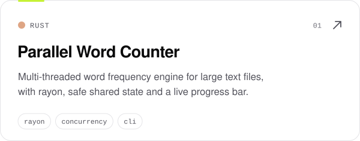
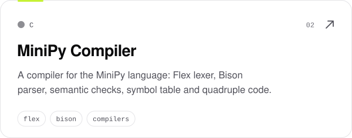
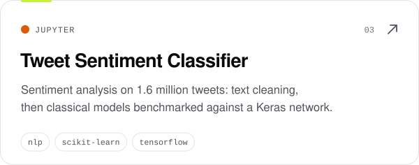
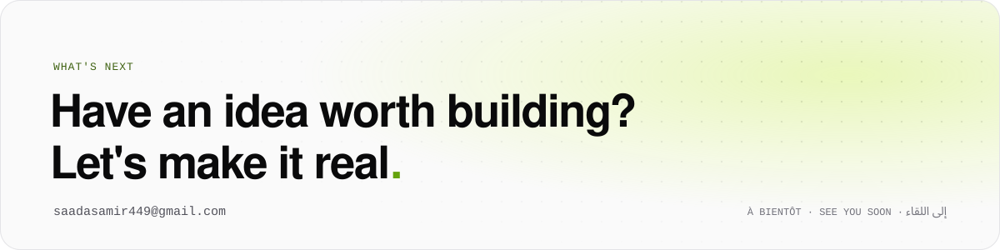

<!--
  Profile README. The visuals in assets/ are generated by scripts/build-assets.mjs:
  edit the texts there, then run `node scripts/build-assets.mjs` and commit.
-->

<picture>
  <source media="(prefers-color-scheme: dark)" srcset="https://raw.githubusercontent.com/SaadaSamir/SaadaSamir/main/assets/hero-dark.svg">
  
</picture>

  <a href="mailto:saadasamir449@gmail.com"><picture><source media="(prefers-color-scheme: dark)" srcset="https://raw.githubusercontent.com/SaadaSamir/SaadaSamir/main/assets/buttons/talk-dark.svg"></picture></a>&nbsp;
  <a href="https://dz.linkedin.com/in/samir-saada-5667b1245"><picture><source media="(prefers-color-scheme: dark)" srcset="https://raw.githubusercontent.com/SaadaSamir/SaadaSamir/main/assets/buttons/linkedin-dark.svg"></picture></a>&nbsp;
  <a href="https://github.com/SaadaSamir?tab=repositories"><picture><source media="(prefers-color-scheme: dark)" srcset="https://raw.githubusercontent.com/SaadaSamir/SaadaSamir/main/assets/buttons/repos-dark.svg"></picture></a>

<picture>
  <source media="(prefers-color-scheme: dark)" srcset="https://raw.githubusercontent.com/SaadaSamir/SaadaSamir/main/assets/whoami-dark.svg">
  
</picture>

## What I do

<picture>
  <source media="(prefers-color-scheme: dark)" srcset="https://raw.githubusercontent.com/SaadaSamir/SaadaSamir/main/assets/pillars-dark.svg">
  
</picture>

## Selected work

  <a href="https://github.com/SaadaSamir/Parallel-Word-Frequency-Counter"><picture><source media="(prefers-color-scheme: dark)" srcset="https://raw.githubusercontent.com/SaadaSamir/SaadaSamir/main/assets/cards/word-frequency-dark.svg"></picture></a>
  <a href="https://github.com/SaadaSamir/Mini-py-compiler"><picture><source media="(prefers-color-scheme: dark)" srcset="https://raw.githubusercontent.com/SaadaSamir/SaadaSamir/main/assets/cards/mini-py-compiler-dark.svg"></picture></a>
  <a href="https://github.com/SaadaSamir/TweetClassifierML"><picture><source media="(prefers-color-scheme: dark)" srcset="https://raw.githubusercontent.com/SaadaSamir/SaadaSamir/main/assets/cards/tweet-classifier-dark.svg"></picture></a>
  <a href="https://github.com/SaadaSamir/TECH-AGENT"><picture><source media="(prefers-color-scheme: dark)" srcset="https://raw.githubusercontent.com/SaadaSamir/SaadaSamir/main/assets/cards/tech-agent-dark.svg"></picture></a>
  <a href="https://github.com/SaadaSamir/Traitement-Automatique-du-Langage-Naturel"><picture><source media="(prefers-color-scheme: dark)" srcset="https://raw.githubusercontent.com/SaadaSamir/SaadaSamir/main/assets/cards/nlp-labs-dark.svg"></picture></a>
  <a href="https://github.com/SaadaSamir/QR-Code-detection-and-encryption-using-pyzbar"><picture><source media="(prefers-color-scheme: dark)" srcset="https://raw.githubusercontent.com/SaadaSamir/SaadaSamir/main/assets/cards/qr-vision-dark.svg"></picture></a>

Also here: [search and metaheuristics (BFS, DFS, A\*, GA, BSO)](https://github.com/SaadaSamir/Metaheuristic-Project) · [semaphore-synchronised medical cabinet in C](https://github.com/SaadaSamir/semaphore-threaded-medical-cabinet-system) · [data mining labs](https://github.com/SaadaSamir/Data-Mining-Labs) · [computer vision labs](https://github.com/SaadaSamir/TP-vision) · [Sudoku solver](https://github.com/SaadaSamir/Sudoku-Solver-using-Backtracking-Algorithm) · [Scrabble in C](https://github.com/SaadaSamir/Scrabble-Game)

## Toolbox

<table>
  <tr>
    <td><b>AI &amp; data</b></td>
    <td><picture><source media="(prefers-color-scheme: dark)" srcset="https://skillicons.dev/icons?i=python,pytorch,tensorflow,scikitlearn,opencv,matlab&theme=dark"></picture></td>
  </tr>
  <tr>
    <td><b>Back end</b></td>
    <td><picture><source media="(prefers-color-scheme: dark)" srcset="https://skillicons.dev/icons?i=laravel,php,nodejs,expressjs,django,flask&theme=dark"></picture></td>
  </tr>
  <tr>
    <td><b>Front end</b></td>
    <td><picture><source media="(prefers-color-scheme: dark)" srcset="https://skillicons.dev/icons?i=vuejs,react,typescript,javascript,tailwindcss,vite&theme=dark"></picture></td>
  </tr>
  <tr>
    <td><b>Data stores</b></td>
    <td><picture><source media="(prefers-color-scheme: dark)" srcset="https://skillicons.dev/icons?i=postgresql,mysql,mongodb,firebase&theme=dark"></picture></td>
  </tr>
  <tr>
    <td><b>Systems &amp; mobile</b></td>
    <td><picture><source media="(prefers-color-scheme: dark)" srcset="https://skillicons.dev/icons?i=rust,c,cpp,java,cs,kotlin,flutter,dart,swift,qt&theme=dark"></picture></td>
  </tr>
  <tr>
    <td><b>Tooling</b></td>
    <td><picture><source media="(prefers-color-scheme: dark)" srcset="https://skillicons.dev/icons?i=git,github,linux,androidstudio,wordpress&theme=dark"></picture></td>
  </tr>
</table>

<a href="mailto:saadasamir449@gmail.com">
  <picture>
    <source media="(prefers-color-scheme: dark)" srcset="https://raw.githubusercontent.com/SaadaSamir/SaadaSamir/main/assets/footer-dark.svg">
    
  </picture>
</a>
